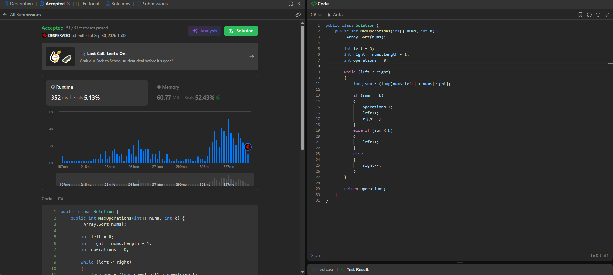

## الحساب

[حساب LeetCode](https://leetcode.com/u/uODsjF4zTG/)

## Max Number of K-Sum Pairs

رابط المسألة: [Max Number of K-Sum Pairs](https://leetcode.com/problems/max-number-of-k-sum-pairs)

لغة الحل: **C#**.

ملف الحل: [Solution.cs](Solution.cs).

الطريقة: ترتيب المصفوفة ثم استخدام مؤشرين من الطرفين. التعقيد الزمني `O(n log n)`.

